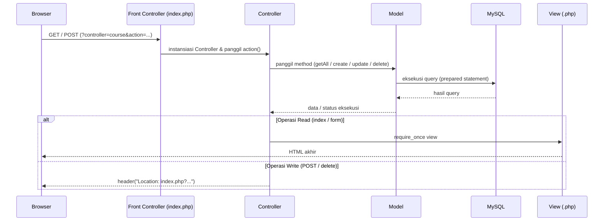
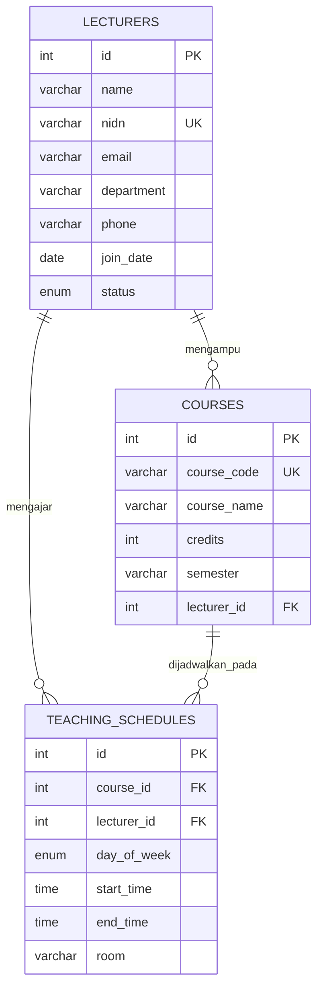
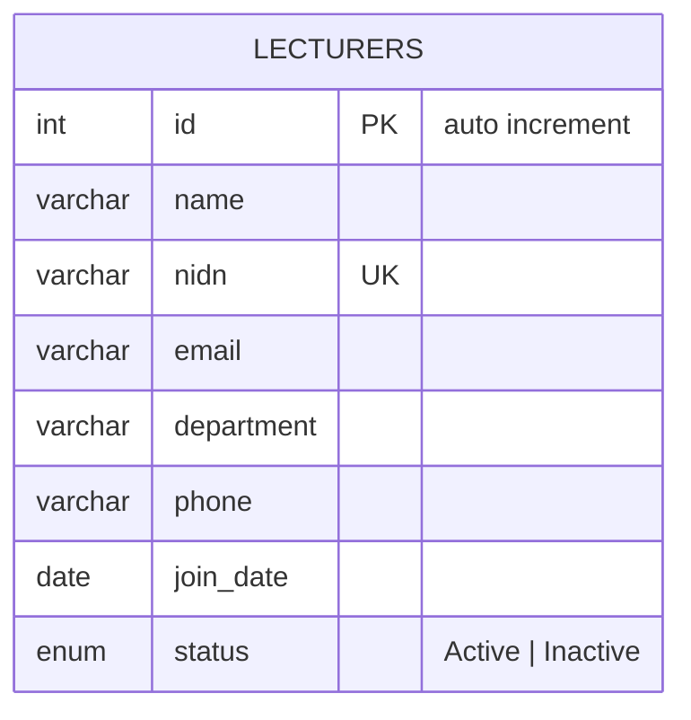
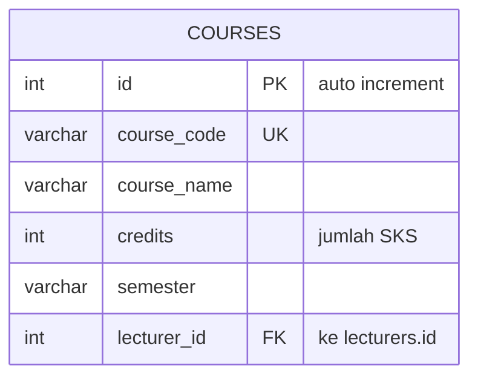
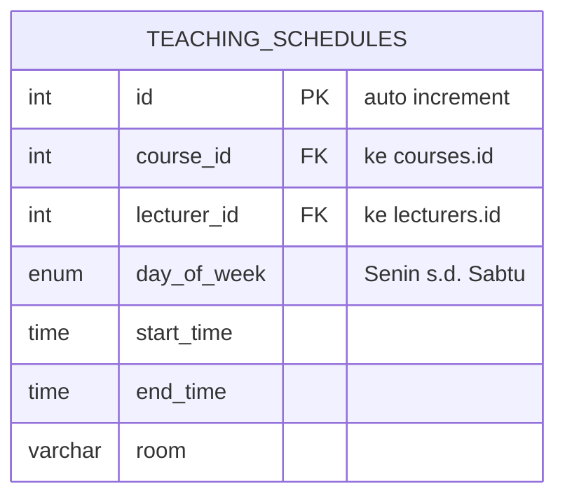

[Uploading README (3).md…]()
# TP8DPBO2526C2

## Janji
Saya **Luthfi Aulia Jodi** dengan NIM **2521743** mengerjakan TP8 dalam mata kuliah DPBO untuk keberkahanNya maka saya tidak melakukan kecurangan seperti yang telah dispesifikasikan. Aamiin.

Aplikasi web **Akademik MVC** untuk mengelola data **Dosen**, **Mata Kuliah**, dan **Jadwal Mengajar**.

## Teknologi

| Komponen | Keterangan |
|---|---|
| Bahasa | PHP Native (tanpa framework), gaya OOP (MVC) |
| Database | MySQL / MariaDB (`mysqli` + prepared statement) |
| Server | XAMPP / Laragon (Apache + phpMyAdmin) |
| Antarmuka | HTML5 + Bootstrap 5 (file lokal di `Project/assets/`) + jQuery |

## Struktur Repositori

```text
.
├── Project/                      # Seluruh source code aplikasi MVC
│   ├── index.php                 # Front Controller (routing controller & action)
│   ├── config/
│   │   └── Database.php          # Konfigurasi & koneksi database (class Database)
│   ├── models/
│   │   ├── Lecturer.php          # Model tabel lecturers
│   │   ├── Course.php            # Model tabel courses
│   │   └── Schedule.php          # Model tabel teaching_schedules
│   ├── views/
│   │   ├── layout/
│   │   │   ├── header.php        # Template navbar & pembuka HTML
│   │   │   └── footer.php        # Template penutup HTML & script JS
│   │   ├── lecturers/
│   │   │   ├── index.php         # Daftar dosen
│   │   │   ├── create.php        # Form tambah dosen
│   │   │   └── edit.php          # Form ubah dosen
│   │   ├── courses/
│   │   │   ├── index.php         # Daftar mata kuliah
│   │   │   ├── create.php        # Form tambah mata kuliah
│   │   │   └── edit.php          # Form ubah mata kuliah
│   │   └── schedules/
│   │       ├── index.php         # Daftar jadwal mengajar
│   │       ├── create.php        # Form tambah jadwal mengajar
│   │       └── edit.php          # Form ubah jadwal mengajar
│   ├── controllers/
│   │   ├── LecturerController.php
│   │   ├── CourseController.php
│   │   └── ScheduleController.php
│   └── assets/
│       ├── bootstrap.min.css
│       ├── bootstrap.bundle.min.js
│       ├── bootstrap.min.js
│       └── jquery.min.js
├── database.sql                  # Struktur tabel + data dummy (tp_mvc25)
├── Dokumentasi/                  # Screenshot & screen record hasil pengujian
└── README.md
```

## Desain Program dan Arsitektur MVC

Kode starter sebelumnya mencampur koneksi database, query SQL, logika alur, dan tampilan HTML dalam satu file PHP (`index.php`, `create.php`, `edit.php`, `delete.php`). Pada versi ini tanggung jawab dipisahkan menjadi tiga lapisan utama menggunakan pola **Front Controller**:

| Lapisan | Folder | Tanggung Jawab |
|---|---|---|
| **Model** | `models/` | Satu-satunya lapisan yang berinteraksi langsung dengan database (`SELECT`, `INSERT`, `UPDATE`, `DELETE` dengan `JOIN` dan *prepared statement*). |
| **View** | `views/` | Menampilkan antarmuka pengguna (tabel data dan form input/edit) menggunakan layout modular (`header.php` & `footer.php`) serta melakukan escaping HTML (`htmlspecialchars`). |
| **Controller** | `controllers/` | Penghubung Model dan View: menerima request (`$_GET` / `$_POST`), memanggil method Model, lalu merender View atau melakukan redirect setelah operasi tulis. **Tidak ada query SQL** di controller. |

Entry point tunggal (`Project/index.php`) membaca parameter `?controller=...&action=...` (default: `lecturer` dan `index`) untuk memanggil Controller dan method yang sesuai.

### Penjelasan Class

| Class | File | Peran |
|---|---|---|
| `Database` | `config/Database.php` | Mengelola koneksi MySQLi (`localhost`, `root`, password kosong, database `tp_mvc25`, charset `utf8mb4`). |
| `Lecturer` | `models/Lecturer.php` | Operasi CRUD pada tabel `lecturers`: `getAll()`, `getById()`, `create()`, `update()`, `delete()`. |
| `Course` | `models/Course.php` | Operasi CRUD pada tabel `courses` beserta relasi dosen: `getAllWithLecturer()`, `getById()`, `create()`, `update()`, `delete()`. |
| `Schedule` | `models/Schedule.php` | Operasi CRUD pada tabel `teaching_schedules` beserta relasi mata kuliah & dosen: `getAllWithDetails()`, `getById()`, `create()`, `update()`, `delete()`. |
| `LecturerController` | `controllers/LecturerController.php` | Mengatur alur `index()`, `create()`, `edit()`, dan `delete()` untuk entitas Dosen. |
| `CourseController` | `controllers/CourseController.php` | Mengatur alur `index()`, `create()`, `edit()`, dan `delete()` untuk entitas Mata Kuliah serta menyediakan daftar dosen untuk dropdown. |
| `ScheduleController` | `controllers/ScheduleController.php` | Mengatur alur `index()`, `create()`, `edit()`, dan `delete()` untuk entitas Jadwal Mengajar serta menyediakan daftar mata kuliah & dosen untuk dropdown. |

### Alur Satu Request



Untuk operasi tulis (tambah, ubah, hapus), controller menerapkan pola *Post/Redirect/Get* dengan mengarahkan kembali (`header("Location: ...")`) ke halaman daftar setelah proses selesai agar refresh halaman tidak mengirim ulang data form.

## Skema Database dan ERD

Database: **`tp_mvc25`**. Tabel `lecturers` berasal dari kode starter dan diperluas atributnya, sedangkan `courses` dan `teaching_schedules` adalah dua tabel baru yang saling berelasi.



**Penjelasan gambar ERD:** diagram di atas menunjukkan tiga tabel beserta hubungan antar-tabelnya. Garis dengan simbol `||--o{` dibaca "satu ke banyak": satu dosen dapat mengampu banyak mata kuliah (`LECTURERS` -> `COURSES`), satu dosen dapat memiliki banyak jadwal mengajar (`LECTURERS` -> `TEACHING_SCHEDULES`), dan satu mata kuliah dapat muncul di banyak jadwal (`COURSES` -> `TEACHING_SCHEDULES`). Tabel `teaching_schedules` berada di posisi paling "anak" karena memiliki dua foreign key sekaligus, yaitu ke `courses` dan `lecturers`.

### Penjelasan Tabel

| Tabel | Status | Keterangan |
|---|---|---|
| `lecturers` | Lama (diperluas) | Atribut lama: `id`, `name`, `nidn`, `phone`, `join_date`. Atribut baru: `email`, `department`, `status` (`Active` / `Inactive`). |
| `courses` | **Baru** | Data mata kuliah: `course_code`, `course_name`, `credits` (SKS), `semester`, dan `lecturer_id` (FK ke `lecturers.id`). |
| `teaching_schedules` | **Baru** | Data jadwal perkuliahan: `course_id` (FK ke `courses.id`), `lecturer_id` (FK ke `lecturers.id`), `day_of_week`, `start_time`, `end_time`, dan `room`. |

### Visual Struktur Tiap Tabel

Setiap diagram di bawah ini menampilkan satu tabel lengkap dengan kolom, tipe data, dan penanda kunci (`PK` = Primary Key, `FK` = Foreign Key, `UK` = Unique Key).

#### 1. Tabel `lecturers`



**Penjelasan:** tabel induk yang menyimpan data dosen. Kolom `id` adalah primary key, sedangkan `nidn` bersifat unik sehingga tidak ada dua dosen dengan NIDN yang sama. Kolom `name`, `nidn`, `phone`, dan `join_date` berasal dari kode starter, sementara `email`, `department`, dan `status` (hanya boleh `Active` atau `Inactive`) adalah atribut tambahan. Tabel ini tidak memiliki foreign key karena menjadi tujuan referensi dari `courses` dan `teaching_schedules`.

#### 2. Tabel `courses`



**Penjelasan:** tabel baru yang menyimpan data mata kuliah. `course_code` bersifat unik untuk mencegah kode mata kuliah ganda, dan `credits` menyimpan jumlah SKS. Kolom `lecturer_id` adalah foreign key ke `lecturers.id` yang menandakan dosen pengampu mata kuliah tersebut. Karena relasinya `ON DELETE CASCADE`, menghapus seorang dosen juga menghapus mata kuliah yang diampunya.

#### 3. Tabel `teaching_schedules`



**Penjelasan:** tabel baru yang menyimpan jadwal perkuliahan dan menghubungkan dua tabel lain. `course_id` menunjuk ke mata kuliah yang dijadwalkan, `lecturer_id` menunjuk ke dosen yang mengajar, sedangkan `day_of_week`, `start_time`, `end_time`, dan `room` menentukan kapan dan di mana kuliah berlangsung. Karena itu halaman daftar jadwal memakai `JOIN` ke `courses` dan `lecturers` untuk menampilkan nama mata kuliah dan nama dosen, bukan sekadar ID.

### Relasi dan Aturan Integritas

| Relasi | Kardinalitas | Foreign Key | Aturan Referensial |
|---|---|---|---|
| Dosen - Mata Kuliah | 1 : N | `courses.lecturer_id` -> `lecturers.id` | `ON DELETE CASCADE`, `ON UPDATE CASCADE` |
| Mata Kuliah - Jadwal Mengajar | 1 : N | `teaching_schedules.course_id` -> `courses.id` | `ON DELETE CASCADE`, `ON UPDATE CASCADE` |
| Dosen - Jadwal Mengajar | 1 : N | `teaching_schedules.lecturer_id` -> `lecturers.id` | `ON DELETE CASCADE`, `ON UPDATE CASCADE` |

- `UNIQUE`: diterapkan pada `lecturers.nidn` dan `courses.course_code` untuk mencegah duplikasi kode identitas.
- `ENUM`: digunakan pada `lecturers.status` (`'Active'`, `'Inactive'`) dan `teaching_schedules.day_of_week` (`'Senin'` s.d. `'Sabtu'`).
- Data awal (*seed*) pada `database.sql` berisi data dummy untuk tabel `lecturers`, `courses`, dan `teaching_schedules` agar relasi `JOIN` langsung terlihat saat pertama dijalankan.

## Alur Kerja Aplikasi (CRUD)

Navigasi pada navbar menyediakan akses ke tiga modul utama: **Lecturers** (`?controller=lecturer&action=index`), **Courses** (`?controller=course&action=index`), dan **Schedules** (`?controller=schedule&action=index`).

| Operasi | Request | Proses |
|---|---|---|
| **Read** | `GET index.php?controller=<modul>&action=index` | Controller memanggil Model untuk mengambil seluruh baris data (dengan `JOIN` pada `courses` dan `teaching_schedules`) lalu menampilkannya ke tabel View. |
| **Create** | `GET ...&action=create` lalu `POST ...&action=create` | Menampilkan form input (dilengkapi `<select>` dinamis dari tabel induk), memproses `POST` lewat `Model::create()`, lalu redirect ke halaman daftar. |
| **Update** | `GET ...&action=edit&id=ID` lalu `POST ...&action=edit&id=ID` | Mengambil data lama berdasarkan `id`, mengisi nilai awal form (`value` & `selected`), memperbarui data via `Model::update()`, lalu redirect ke halaman daftar. |
| **Delete** | `GET ...&action=delete&id=ID` (dengan dialog konfirmasi) | Menampilkan konfirmasi JavaScript (`confirm()`), mengeksekusi `Model::delete($id)`, lalu redirect kembali ke halaman daftar. |

Hal yang ditampilkan melalui relasi antar-tabel:
- **Courses (`courses`)**: Dropdown *Dosen Pengampu* pada form Create/Edit diambil dari tabel `lecturers`; tabel daftar menampilkan nama dosen beserta NIDN melalui `JOIN lecturers`.
- **Teaching Schedules (`teaching_schedules`)**: Dropdown *Mata Kuliah* dan *Dosen* pada form diambil dari `courses` dan `lecturers`; tabel daftar menampilkan kode & nama mata kuliah serta nama dosen pengajar melalui `JOIN courses` dan `JOIN lecturers`.

## Keamanan

| Ancaman | Penanganan |
|---|---|
| SQL Injection | Semua query dengan parameter (`getById`, `create`, `update`, `delete`) menggunakan **prepared statement** (`prepare()` dan `bind_param()`). |
| XSS (Cross-Site Scripting) | Seluruh output data dari database di-escape menggunakan `htmlspecialchars()` sebelum dicetak di View. |
| Penghapusan Tidak Sengaja | Tombol *Delete* dilengkapi dialog konfirmasi JavaScript (`onclick="return confirm(...)"`) sebelum menjalankan aksi hapus. |
| Integritas Tipe Data | Parameter ID dan angka dikonversi secara eksplisit ke integer (`(int)`) di Controller sebelum diteruskan ke Model. |

## Cara Menjalankan (XAMPP)

1. Jalankan **XAMPP Control Panel**, lalu klik **Start** pada **Apache** dan **MySQL**.
2. Pastikan folder `Project/` berada di dalam direktori `htdocs` XAMPP (misalnya `C:\xampp\htdocs\TP8DPBO2526C2\Project\`).
3. Buka phpMyAdmin (`http://localhost/phpmyadmin`), pilih tab **Import** atau **SQL**, lalu jalankan file `database.sql` untuk membuat database `tp_mvc25` beserta tabel dan data awalnya.
4. Jika konfigurasi MySQL berbeda dari default (`root` tanpa password), sesuaikan properti di `Project/config/Database.php`.
5. Buka browser dan akses:
   `http://localhost/TP8DPBO2526C2/Project/index.php`
